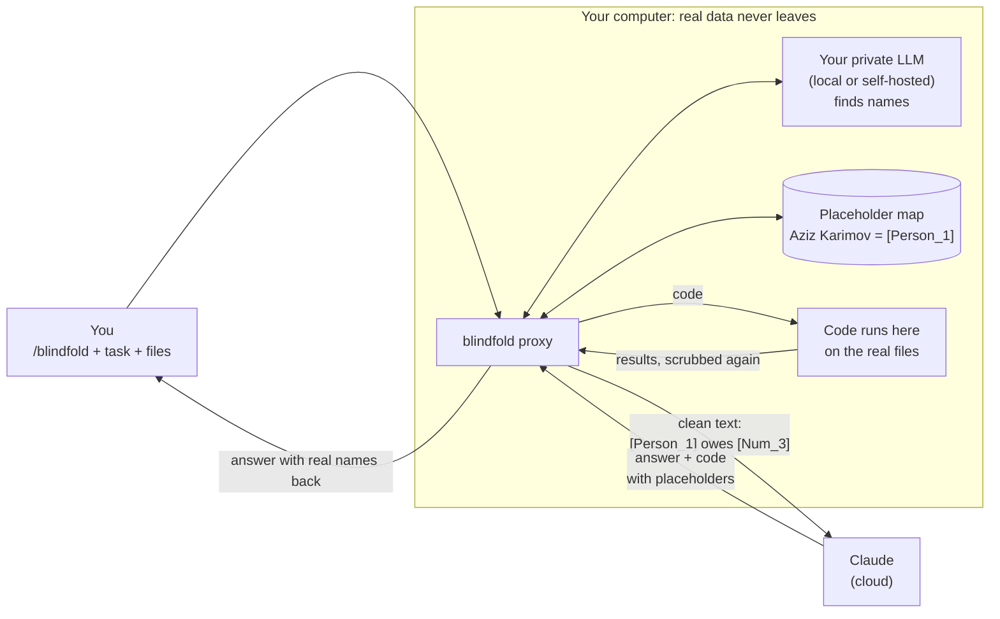

# blindfold

Use Claude Code on private data without Claude seeing the private parts.

Type `/blindfold` before a task. Names, IDs, accounts, cards and phones are swapped for placeholders like `[Person_1]` before anything leaves your computer. Claude writes the code, the code runs on your machine on the real data, and you read the answer with the real values back in place.

Without `/blindfold`, Claude Code works exactly as before.

## How it works



In plain steps:

1. **You ask.** Type `/blindfold` (or `/blindfold strict`) and your task, as usual.
2. **blindfold hides.** A small program on your computer finds private values and swaps each for a placeholder. The same value always gets the same placeholder.
3. **Claude works blind.** Claude sees `[Person_1]`, never the name. It still sees the structure: columns, sentences, which value is which.
4. **Code runs locally.** When Claude writes code, it runs on your machine on the real files. Its output is scrubbed again before Claude reads it.
5. **You read the real thing.** Placeholders in Claude's answer are swapped back to the real values on your screen.

## What gets hidden

| Depth | Hidden from Claude |
|---|---|
| `/blindfold` | Names, organisations, IDs, accounts, cards, phones, emails, passports, addresses. Client tables over 50 rows. |
| `/blindfold strict` | All of the above, plus every number and date. |

Finding values works in layers, cheapest first:

1. **Pattern rules.** IDs with checksums, cards, accounts, phones, emails.
2. **Labels and column headers.** "Name:", "Phone", "F.I.Sh."
3. **Name shapes.** Surname endings, first-name lists, word forms.
4. **Your private LLM.** Catches names the rules miss. Optional.
5. **Spreading.** A name found once is hidden everywhere in the session.

## Use any private LLM

Layer 4 calls any OpenAI-compatible endpoint you control: Ollama, vLLM, LM Studio, or a self-hosted server. Set it in `%USERPROFILE%\.blindfold\config.json`:

```json
{ "llm_base_url": "http://127.0.0.1:11434/v1", "llm_model": "your-model" }
```

Leave `llm_base_url` empty to run on rules only.

## Install (Windows)

1. Run in an administrator PowerShell:

       powershell -ExecutionPolicy Bypass -File deploy\install.ps1

2. Set `llm_base_url` in `config.json` (see above), or leave it empty.
3. Sign in to Claude Code with `/login`.

## Use

    /blindfold            hide identifiers; other numbers stay visible
    /blindfold strict     hide every number as well

## Test results (synthetic data)

| Test | Result |
|---|---|
| Leaks across xlsx, csv, docx, pptx, pdf, md, html | **0 of 106** fake values reached Claude |
| Values restored in the answer | **106 of 106** |
| Answer quality vs plain Claude (10 tasks, AI judge) | blindfold won 4, plain won 5, 1 split. Plain Claude against a rerun of itself: 5, 1, 4 split. No visible quality loss, but 10 tasks are too few to prove parity. |

Not yet tested on real text. Treat it as a test tool until you measure recall on your own data.

## Develop

    python -m venv .venv
    .venv/Scripts/python -m pip install -e ".[dev]"
    .venv/Scripts/python -m pytest

The name model layer (`use_ner`, GLiNER2) is experimental; the installer turns it off.

## Credits

The streaming restore design follows PrivAiTe (crp4222/PrivAiTe, BSD-3-Clause), used as a reference.
